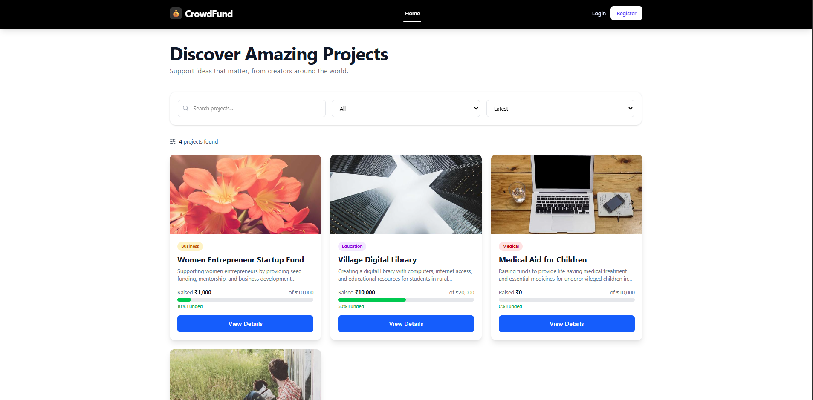
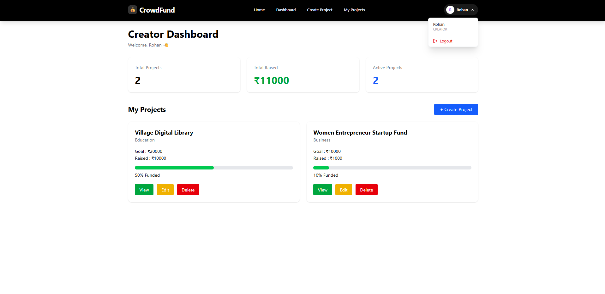
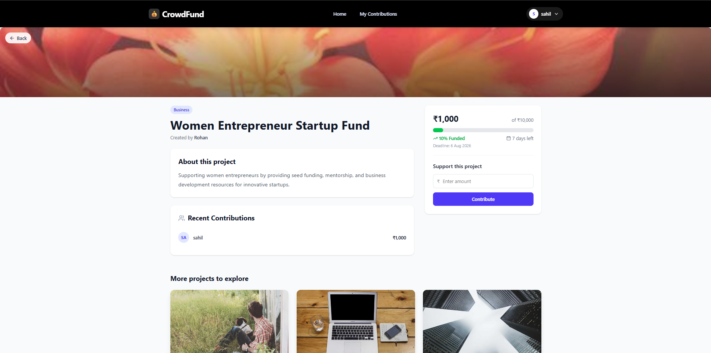

# 🚀 CrowdFunding Platform

A full-stack crowdfunding web application built using **Spring Boot**, **React**, and **MySQL**. The platform allows creators to launch fundraising campaigns and backers to contribute to projects through an easy-to-use interface.

---

## 📌 Features

### 👤 User Authentication
- User Registration
- User Login
- Role-based access (Creator & Backer)
- Session management using Local Storage

---

### 🎯 Creator Features

- Create new fundraising projects
- View Creator Dashboard
- View all created projects
- Delete projects
- Track project progress
- View total funds raised
- View active projects

---

### 💰 Backer Features

- Browse all projects
- Search projects
- Filter projects by category
- Sort projects
- View project details
- Contribute to projects
- View contribution history

---

### 📊 Dashboard

Creator Dashboard includes:

- Total Projects
- Total Raised Amount
- Active Projects
- Project Progress Bars

---

### 🔍 Search & Filter

- Search projects by title
- Filter by category
- Sort by:
  - Latest
  - Highest Goal
  - Most Funded

---

## 🛠 Tech Stack

### Frontend

- React.js (Vite)
- Tailwind CSS
- Axios
- React Router DOM

### Backend

- Spring Boot
- Spring Data JPA
- Hibernate

### Database

- MySQL

---

## 📂 Project Structure

### Backend

```
Backend
│
├── controller
├── entity
├── repository
├── service
├── serviceImpl
├── dto
└── CrowdFundingApplication.java
```

### Frontend

```
src
│
├── assets
├── components
│     ├── Navbar.jsx
│     ├── ProjectCard.jsx
│
├── pages
│     ├── Home.jsx
│     ├── Login.jsx
│     ├── Register.jsx
│     ├── CreateProject.jsx
│     ├── ProjectDetails.jsx
│     ├── CreatorDashboard.jsx
│     ├── MyContributions.jsx
│
├── services
│     └── api.js
│
├── App.jsx
└── main.jsx
```

---

## 📋 Database Tables

### User

| Field | Type |
|-------|------|
| id | Long |
| name | String |
| email | String |
| password | String |
| role | String |

---

### Project

| Field | Type |
|-------|------|
| id | Long |
| title | String |
| description | String |
| category | String |
| goalAmount | Double |
| currentAmount | Double |
| deadline | String |
| creator | User |

---

### Contribution

| Field | Type |
|-------|------|
| id | Long |
| amount | Double |
| project | Project |
| user | User |

---

## 📡 REST APIs

### User APIs

| Method | Endpoint |
|---------|----------|
| POST | `/api/users/register` |
| POST | `/api/users/login` |
| GET | `/api/users` |
| GET | `/api/users/{id}` |

---

### Project APIs

| Method | Endpoint |
|---------|----------|
| POST | `/api/projects` |
| GET | `/api/projects` |
| GET | `/api/projects/{id}` |
| GET | `/api/projects/creator/{creatorId}` |
| DELETE | `/api/projects/{id}` |

---

### Contribution APIs

| Method | Endpoint |
|---------|----------|
| POST | `/api/contributions` |
| GET | `/api/contributions/project/{projectId}` |
| GET | `/api/contributions/user/{userId}` |

---

## ⚙️ Installation

### Clone Repository

```bash
git clone https://github.com/yourusername/crowdfunding-platform.git
```

---

## 🗄️ Database Setup

### Step 1: Open MySQL

Login to your MySQL server using MySQL Workbench or the MySQL command line.

### Step 2: Create Database

Run the following SQL command:

```sql
CREATE DATABASE crowdfunding;
```

Verify that the database has been created:

```sql
SHOW DATABASES;
```

Select the database:

```sql
USE crowdfunding;
```

> **Note:** You do not need to manually create tables. Spring Boot with Hibernate will automatically create all required tables when the application starts.

---


### Backend Setup

```bash
cd Backend
```

Configure MySQL in:

```properties
application.properties
```

```properties
spring.datasource.url=jdbc:mysql://localhost:3306/crowdfunding
spring.datasource.username=root
spring.datasource.password=
```

Run Spring Boot application.

---

### Frontend Setup

```bash
cd frontend

npm install

npm run dev
```

Frontend will run at:

```
http://localhost:5173
```

Backend:

```
http://localhost:8080
```

---

## 🎨 Screens

- Home Page
- Login
- Register
- Create Project
- Project Details
- Creator Dashboard
- My Contributions

---

## 🚧 Future Enhancements

- JWT Authentication
- Spring Security
- Payment Gateway Integration (Stripe/Razorpay)
- Image Upload
- Comments on Projects
- Project Approval Workflow
- Admin Dashboard
- Email Notifications
- Project Editing
- Project Analytics
- Wishlist/Favorites
- Pagination
- Dark Mode

---

## 📸 Demo

### Home Page

- Browse crowdfunding campaigns
- Search & Filter projects
- View fundraising progress

### Creator Dashboard

- Manage projects
- Track donations
- Monitor fundraising progress

### Project Details

- Project information
- Donation form
- Recent contributions
- Related projects

---


## 📄 License

This project is developed for educational and learning purposes.